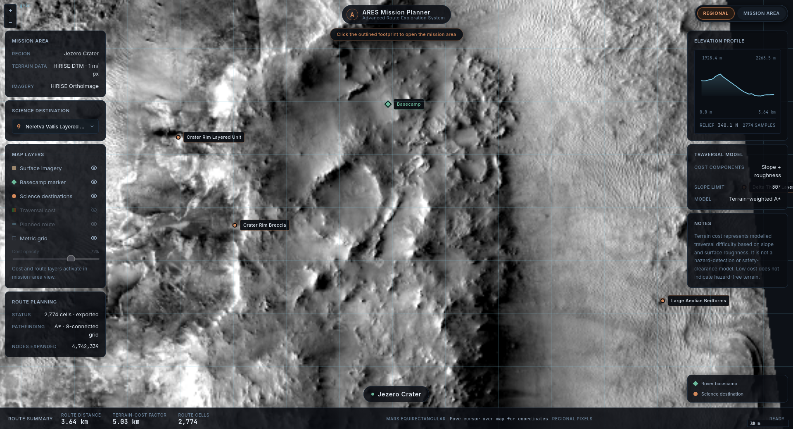
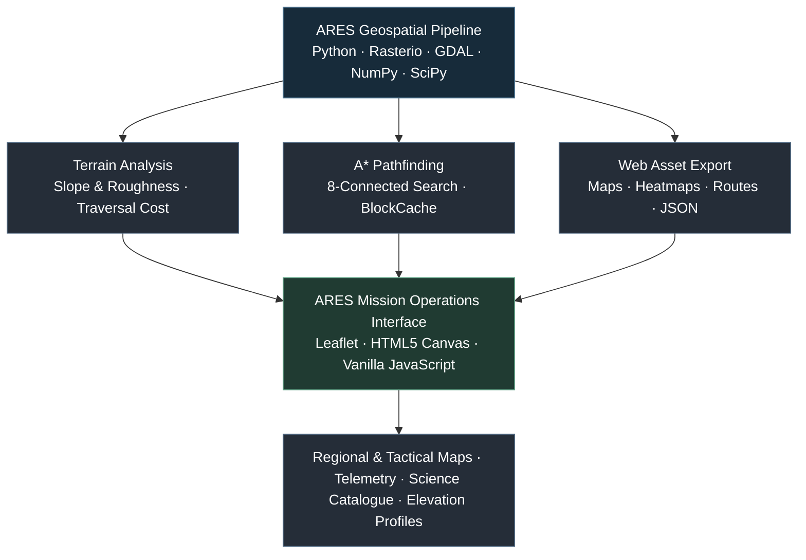

<p align="center">
  
</p>

# ARES - Advanced Route Exploration System

[](https://www.spaceappschallenge.org/)
[](https://www.python.org/)
[](https://rasterio.readthedocs.io/)
[](https://numpy.org/)
[](https://scipy.org/)
[](https://leafletjs.com/)
[](https://docs.pytest.org/)

**Terrain-aware surface route planning and geospatial exploration system for future human Extravehicular Activities (EVA) and robotic reconnaissance on Mars.**

## Quick Project Links

- **Live Application:** [Launch ARES](https://ares-web-coral.vercel.app/)
- **Project Demonstration (PDF):** [pdf](demo/ARES_demo.pdf) | [pptx](demo/ARES_demo.pptx)

---

ARES was developed as an exploration operations prototype for the **NASA Space Apps Challenge 2026**, focused on the **Jezero Crater and western inlet region (Neretva Vallis)** on Mars ($77^\circ\text{E}, 18^\circ\text{N}$). The system ingests sub-meter orbital elevation and optical data, models surface traversability constraints (slopes, roughness, impassable hazards), and computes optimal exploration traverses between mission basecamp staging areas and high-priority geological science destinations.

Key challenge objectives addressed:

- **Localized Surface Mapping:** Provides a high-resolution, 1 m/pixel tactical exploration environment rather than relying exclusively on regional orbital maps.
- **Multi-Source Data Integration:** Combines HiRISE topographic and optical products with geological mapping references and Perseverance rover observations.
- **Terrain-Aware Navigation:** Models slope and surface roughness to identify hazardous terrain and generate traversable routes between mission staging areas and scientific targets.
- **Science-Driven Exploration:** Connects geological destinations with scientific objectives, orbital morphology evidence, and relevant rover observations.
- **Mission Situational Awareness:** Provides route telemetry, spatial coordinates, elevation profiles, and interactive terrain visualization through a unified mission operations interface.

ARES demonstrates how existing planetary science datasets can be brought together into a localized exploration environment to support future human and robotic reconnaissance missions.

Developed by **Team Thestrals**
- **Sreegovind P**
- **Suraj Krishna K**

---

## Table of Contents

- [System Architecture](#system-architecture)
- [Key Features](#key-features)
  - [Backend Geospatial & Pathfinding Pipeline](#backend-geospatial--pathfinding-pipeline)
  - [Frontend Mission Operations Interface](#frontend-mission-operations-interface)
- [Scientific Target Catalogue](#scientific-target-catalogue)
- [Implementation Status & Limitations](#implementation-status--limitations)
- [Data Sources & Planetary References](#data-sources--planetary-references)
- [Installation & Setup](#installation--setup)
- [Usage Guide](#usage-guide)
  - [Running the Pipeline](#running-the-pipeline)
  - [Running the Test Suite](#running-the-test-suite)
  - [Launching the Web Application](#launching-the-web-application)
- [Repository Structure](#repository-structure)
- [License & Acknowledgements](#license--acknowledgements)

---

## System Architecture

ARES is structured as two decoupled, high-performance systems:



1. **Geospatial Processing & Pathfinding Core (`src/ares_pipeline/`)**:
   A deterministic Python pipeline executing memory-efficient raster operations over high-resolution HiRISE datasets ($19,144 \times 26,816$ raster cells at 1 m/pixel resolution, exceeding 513 million cells). It generates terrain hazard surfaces, validates site traversability, runs out-of-core A* graph searches, and packages production web assets.

2. **Interactive Mission Operations Client (`web/`)**:
   A telemetry-inspired, full-bleed single-page web interface built adhering to strict low-cognitive-load design principles (`unslop.md`). Features dual synoptic/tactical modes, floating telemetry HUDs, live coordinate tracking, interactive elevation cross-sections, and deep scientific dossiers with peer-reviewed literature context.

---

## Key Features

### Backend Geospatial & Pathfinding Pipeline

The backend pipeline located in `src/ares_pipeline/` comprises dedicated modules for each stage of geospatial extraction and route synthesis:

#### 1. Terrain Analysis & Traversal Cost Modeling (`terrain.py`)
- **Slope Derivation**: Calculates physical terrain slopes in degrees across the Martian datum using Horn's method spatial gradient operator over the 1 m/pixel DTM.
- **Detrended Surface Roughness**: Computes short-wavelength roughness via local moving planar regressions, isolating sub-meter topographic noise and boulder field turbulence from regional regional relief.
- **Unified Traversal Cost Function**:
  $$\text{Cost} = w_{\text{slope}} \cdot \overline{\text{Slope}} + w_{\text{roughness}} \cdot \overline{\text{Roughness}}$$
  Normalized across valid terrain percentiles.
- **Hard Traversability Boundary**: Enforces a strict $30^\circ$ maximum slope threshold. Grid cells with slopes exceeding $30^\circ$ or lacking valid elevation data (NoData voids) are encoded as impassable barriers (`+inf` cost).

#### 2. Out-of-Core A* Pathfinding (`pathfind.py`)
- **8-Connected Grid Search**: Computes optimal traversals supporting horizontal, vertical, and diagonal movements ($1$ and $\sqrt{2}$ spatial increments).
- **BlockCache Memory Paging**: Implements a tiled LRU raster cache that reads GeoTIFF blocks on demand, permitting deterministic pathfinding over gigabyte-scale rasters (over 513 million cells) without exceeding standard workstation memory.
- **Diagonal Hazard Prevention**: Enforces strict corner-cutting checks to prevent routes from clipping diagonally across the vertex of an impassable cell or cliff edge.
- **Admissible Octile Heuristic**: Employs an octile distance metric scaled by the theoretical minimum traversal cost, ensuring strictly admissible, optimal paths.
- **Expansion Metrics**: Tracks search statistics, including total nodes expanded, geometric distance in meters, and cumulative terrain-weighted cost equivalent.

#### 3. Orbital Alignment & Validation (`align.py`)
- Verifies coordinate reference systems, pixel bounding boxes, and spatial resolution ratios between HiRISE DTMs (1 m/px), orthoimage mosaics (0.25 m/px), and confidence masks.
- Windowed high-throughput resampling using bilinear interpolation to match grids without edge distortions.

#### 4. Planetary Coordinates & Projections (`coordinates.py`)
- Bidirectional transformations between:
  - **Mars Equirectangular projection** (meters easting/northing, spherical Mars radius $R = 3{,}396{,}190\text{ m}$).
  - **Planetocentric coordinates** (degrees east-positive longitude and planetocentric latitude).
  - **Raster image space** (column/row pixel coordinates).

#### 5. Science Site Validation (`science_sites.py`)
- Ingests candidate exploration waypoints and verifies local traversability against cost and slope rasters.
- **Nearest-Passable Search**: If an orbital coordinate falls on a locally impassable cell (e.g., steep crater rim ledge), an automated spiral search finds the nearest valid, traversable cell within a defined radius.

#### 6. Multi-Destination Route Orchestration (`mission_routes.py`)
- Loads the mission basecamp (Candidate 4) and all validated science targets.
- Performs batch route generation, exporting verified paths to OGC GeoPackages with full line geometries and traversal metrics.

#### 7. Web Asset Packaging (`web_export.py` & `export.py`)
- Generates subsampled regional surface overviews (`surface-overview.png`, $1462 \times 2048$ px).
- Crops high-resolution tactical mission area windows ($4000 \times 4000\text{ m}$ at 1 m/px) centered around the operational zone.
- Colorizes traversal cost heatmaps with normalized green-yellow-red RGBA overlays.
- Samples high-density route elevation profiles (distance, elevation, slope, traversal cost) along the polyline.
- Outputs structured metadata bundles (`destinations.json`, `mission.json`, `route.json`).

---

### Frontend Mission Operations Interface

Built using modern web standards (ES6 modules, HTML5 Canvas, Leaflet GIS) with a quiet, high-contrast dark telemetry aesthetic:

- **Edge-to-Edge Full-Bleed Map**: The map canvas occupies 100% of the viewport with no bulky static framing, giving maximum visual priority to Martian surface topography.
- **Dual Operational Modes**:
  - **Regional View**: Synoptic overview displaying the Jezero Crater footprint, surrounding terrain, mission boundary outlines, basecamp diamond marker, and interactive science target pins.
  - **Mission Area View**: Tactical 1 m/pixel high-resolution mode focused on the active 4 km exploration zone, displaying fine sand ripples, rock fields, cost heatmaps, and active route paths.
- **Floating Telemetry Panels**:
  - Glassmorphic translucent cards grouped on the left and right margins that preserve map visibility while providing mission-critical operational context.
  - **Layer Controls**: Eye-icon toggle buttons on the right of each layer item to toggle surface orthoimagery, traversal cost heatmap, planned route polyline, metric grid, and orbital footprints.
  - **Waypoint Selector**: Modern custom select dropdown with active destination indicator.
  - **Route Planning Telemetry**: Displays route status, pathfinding algorithm (A* 8-connected grid), nodes expanded, and cell counts.
  - **Traversal Model Specs**: Displays cost components (slope + roughness), slope cutoff ($30^\circ$), and model notes.
- **Floating Centered HUD**:
  - Top header brand pill: `ARES Mission Planner · Advanced Route Exploration System`.
  - Centered bottom location pill: `Jezero Crater`.
- **Dedicated Stacked Legends**:
  - Aligned to the far-right above the footer: Traversal Cost Gradient legend (`Low` green $\to$ `High` red) and Map Symbology legend (`Planned route`, `Basecamp`, `Science destination`).
- **Persistent Metric Coordinate Grid**:
  - Custom canvas overlay layer rendering dynamic metric grid lines ($500\text{ m}$ in Regional view, $250\text{ m}$ in Mission Area view) layered directly over the terrain with crisp distance labels.
- **Interactive Science Destination Catalogue Modal**:
  - Modal with sticky header displaying target name, geological unit badge, key metrics (direct distance, route length, cost equivalent), and an instant `Route from basecamp` button.
  - In-depth geological analysis: formation summary, exploration objectives, orbital morphology evidence, and Mars 2020 Perseverance rover comparisons (Mastcam-Z, SuperCam RMI, RIMFAX subsurface radar).
  - Expandable peer-reviewed scientific citations accordion.
- **Real-Time Interactive Elevation Profile**:
  - Persistent bottom summary bar with live cursor coordinates in planetocentric coordinates, route distance, and modeled cost equivalent.
  - Expandable bottom drawer featuring an HTML5 Canvas cross-section chart showing cumulative distance, terrain elevation, slope angles, and local traversal costs along every meter of the path.
  - Interactive profile scrub: hovering over the elevation chart renders a synchronized marker on the map.

---

## Scientific Target Catalogue

ARES incorporates 5 geologically diverse exploration destinations within the Jezero Crater western delta and rim region, evaluated from a centralized staging basecamp:

| Destination ID | Target Name | Geological Unit | Direct Dist. | Route Length | Modeled Cost Equiv. |
| :--- | :--- | :--- | :---: | :---: | :---: |
| `candidate-4-basecamp` | **Mission Basecamp** (Staging Point) | Smooth floor deposits | — | — | — |
| `neretva-vallis-layered-unit` | **Neretva Vallis Layered Unit** | Neretva Vallis layered (NV-l) | 3,119 m | 3,643 m | 5,026 m |
| `crater-rim-breccia` | **Crater Rim Breccia** | Jezero crater rim unit | 1,642 m | 1,920 m | 2,477 m |
| `crater-rim-layered-unit` | **Crater Rim Layered Unit** | Crater rim layered unit | 1,798 m | 2,118 m | 2,719 m |
| `large-aeolian-bedforms` | **Large Aeolian Bedforms** | Modern aeolian bedforms | 2,875 m | 3,352 m | 4,309 m |
| `delta-thinly-layered-unit` | **Delta Thinly Layered Unit** | Western delta bottomset/foresets | 3,061 m | 3,681 m | 4,556 m |

---

## Implementation Status & Limitations

> [!IMPORTANT]
> ### Known Unimplemented Feature: Arbitrary Two-Point Custom Routing
> **The ability to click any two arbitrary points on the map or pass arbitrary start/end coordinate pairs via CLI to calculate an ad-hoc route on-the-fly is currently NOT implemented.**
>
> In the current release, ARES operates on **precomputed, verified route bundles** linking the designated Basecamp to the 5 target science destinations. The full pathfinding engine (`pathfind.py`) is fully capable of arbitrary routing, but the real-time client-to-backend routing bridge or browser-side graph solver is reserved for a future release.

### Prototype Advisory
ARES is an experimental mission planning prototype developed for scientific analysis and simulation. It is **not** a certified real-time spacecraft guidance system or hazard-avoidance safety system. Traversal costs reflect modeled slopes and surface roughness derived from orbital data, and do not replace tactile micro-hazard detection (e.g., loose regolith, fine wheel sinkage, or crevasses smaller than 1 m).

---

## Data Sources & Planetary References

- **Primary Orbital Data**:
  - *Mars Sample Return (MSR) Terrain Relative Navigation (TRN) HiRISE DTM and Orthoimage Mosaics*
  - Instrument: High Resolution Imaging Science Experiment (HiRISE) aboard Mars Reconnaissance Orbiter (MRO)
  - Processing: USGS Astrogeology Science Center / NASA Jet Propulsion Laboratory (JPL)
  - DOI: [10.5066/P13CPYYU](https://doi.org/10.5066/P13CPYYU)
- **Geological Mapping & In-Situ Science References**:
  - Stack et al. (2020), *Photogeologic Map of the Perseverance Rover Field Site in Jezero Crater*, Space Sci Rev, [doi:10.1007/s11214-020-00739-x](https://doi.org/10.1007/s11214-020-00739-x).
  - Jones et al. (2026) / Farley et al., Mars 2020 Perseverance science team traverse reports, Neretva Vallis and Bright Angel investigations.

---

## Integrated Science Data

ARES organizes planetary observations into complementary information layers:

| Data Category | Source | Application in ARES |
|---|---|---|
| Topographic | HiRISE DTM | Elevation, slope and terrain analysis |
| Optical | HiRISE Orthoimage | Surface morphology and visual terrain inspection |
| Geological | Published Jezero geological mapping | Identification and interpretation of scientific targets |
| Rover Observations | Mars 2020 Perseverance | In-situ geological context and exploration references |
| Terrain Confidence | HiRISE Confidence Mosaic | Supporting terrain data quality assessment |

The integrated datasets provide complementary perspectives on the exploration environment, connecting orbital surface measurements with geological interpretation and ground-level scientific observations.

**Future Data Integration:** CRISM hyperspectral observations and THEMIS thermal infrared datasets have been identified as potential additional sources for mineralogical and thermal context. Their spatial coverage and product-level verification are deferred and are not currently incorporated into the operational interface.

---

## Human Exploration Context

ARES is designed around the operational requirements of future crewed Mars surface excursions.

The mission planning workflow considers:

- **Traverse Safety:** Avoidance of steep slopes and high-roughness terrain using orbital-derived traversability models.
- **Mission Planning:** Precomputed routes connecting a centralized staging basecamp with scientifically significant destinations.
- **Scientific Decision Support:** Geological dossiers provide contextual information and exploration objectives before reaching a destination.
- **Terrain Awareness:** Elevation cross-sections and spatial overlays help explorers understand the topographic characteristics of planned traverses.
- **Orbital-to-Surface Context:** Regional rover imagery and scientific observations provide additional context for interpreting geological features encountered during exploration.

The current implementation is a planning and visualization prototype. It does not provide live environmental monitoring, real-time hazard detection, spacesuit mobility simulation, or certified astronaut navigation.

---

## Installation & Setup

### Prerequisites

- **Python**: 3.12 or newer
- **Package Manager**: [`uv`](https://docs.astral.sh/uv/) (recommended) or standard `pip`
- **System Geospatial Libraries**: GDAL, PROJ, and GEOS (automatically handled by pre-compiled binary wheels when using `uv`)
- **Web Browser**: Any modern browser supporting ES6 modules and HTML5 Canvas (Chrome, Firefox, Safari, Edge)

### Setup Instructions

1. **Clone the repository**:
   ```bash
   git clone https://github.com/theSpectr06/ares.git
   cd ares
   ```

2. **Install Python dependencies with `uv`**:
   ```bash
   uv sync
   ```

   *(Or using traditional `pip` inside a virtual environment)*:
   ```bash
   python3 -m venv .venv
   source .venv/bin/activate
   pip install -e .
   pip install pytest ruff
   ```

---

## Usage Guide

### Running the Pipeline

The pipeline is organized in modular execution stages:

1. **Stage 2: Spatial Alignment & Validation**
   Coregisters DTM, orthoimages, and confidence rasters:
   ```bash
   uv run python -m ares_pipeline.align
   ```

2. **Stage 3: Terrain Hazard & Cost Surface Generation**
   Derives slope and detrended roughness rasters and generates `cost.tif`:
   ```bash
   uv run python -m ares_pipeline.terrain
   ```

3. **Stage 4: A* Pathfinding Demonstration**
   Executes memory-paged pathfinding between sample coordinates:
   ```bash
   uv run python -m ares_pipeline.pathfind
   ```

4. **Stage 5: Web Asset Preparation**
   Generates downsampled overviews, high-res 1m crops, and JSON metadata bundles for `web/`:
   ```bash
   uv run python -c "
   from pathlib import Path
   from ares_pipeline.web_export import prepare_multi_destination_web_assets

   # Run batch export to web/data
   # (Refer to src/ares_pipeline/web_export.py for full programmatic usage)
   "
   ```

### Running the Test Suite

The test suite contains 79 test cases covering coordinate transformations, grid alignments, slope and roughness kernels, A* search correctness, corner-cutting prevention, and web asset schema integrity:

```bash
uv run pytest
```

To run linting and format verification:
```bash
uv run ruff check .
```

### Launching the Web Application

The web frontend (`web/`) is a client-side application using standard ES6 modules. To avoid CORS restrictions when loading local JSON and image assets, serve it with any local HTTP server:

```bash
# Using Python's built-in HTTP server:
python3 -m http.server 8000 --directory web
```

Then open your browser at:
```
http://localhost:8000
```

---

## Repository Structure

```
ares/
├── src/ares_pipeline/          # Core Python geospatial & pathfinding library
│   ├── __init__.py
│   ├── align.py                # HiRISE DTM/orthoimage coregistration & resampling
│   ├── coordinates.py          # Mars projection, geographic & pixel coordinate transforms
│   ├── export.py               # OGC GeoPackage vector export
│   ├── mission_routes.py       # Multi-destination route computation orchestrator
│   ├── pathfind.py             # 8-connected grid A* pathfinding & BlockCache
│   ├── science_sites.py        # Exploration destination ingestion & validation
│   ├── terrain.py              # Slope, roughness, and cost surface generation
│   └── web_export.py           # Web asset cropping, profile extraction & JSON manifests
├── tests/                      # Automated test suite (79 test cases)
│   ├── test_align.py
│   ├── test_coordinates.py
│   ├── test_export.py
│   ├── test_mission_routes.py
│   ├── test_pathfind.py
│   ├── test_science_sites.py
│   ├── test_smoke.py
│   ├── test_terrain.py
│   └── test_web_export.py
├── data-pipeline/              # Data processing working directories
│   ├── raw/                    # Raw HiRISE DTM, orthoimage & confidence rasters
│   ├── reference/              # Orbital footprints & GIS references
│   └── output/                 # Generated slope, roughness, cost GeoTIFFs & GeoPackages
├── web/                        # Mission operations web client
│   ├── index.html              # Full-bleed application markup & floating HUDs
│   ├── css/
│   │   └── app.css             # High-craft telemetry styling (unslop.md design system)
│   ├── js/
│   │   ├── app.js              # Leaflet application controller, HUD & interactions
│   │   └── elevation-chart.js  # HTML5 Canvas cross-section elevation profile renderer
│   ├── data/                   # Packaged web assets
│   │   ├── destinations.json   # Destination catalogue index
│   │   ├── science-sites.json  # Comprehensive geological research dossiers
│   │   ├── surface-overview.png# Regional synoptic surface mosaic
│   │   └── destinations/       # Per-destination tactical route bundles
│   │       ├── crater-rim-breccia/
│   │       ├── crater-rim-layered-unit/
│   │       ├── delta-thinly-layered-unit/
│   │       ├── large-aeolian-bedforms/
│   │       └── neretva-vallis-layered-unit/
│   └── vendor/                 # Local vendor libraries (Leaflet 1.9.4)
├── pyproject.toml              # Python project metadata, dependencies & tool configs
└── README.md                   # System documentation
```

---

## License & Acknowledgements

Developed for the **NASA Space Apps Challenge 2026**. 

Built with planetary data provided by **NASA**, the **USGS Astrogeology Science Center**, and the **HiRISE / Mars Reconnaissance Orbiter** and **Mars 2020 Perseverance** science teams. Open-source geospatial tooling powered by Rasterio, GDAL, NumPy, SciPy, and Leaflet.
